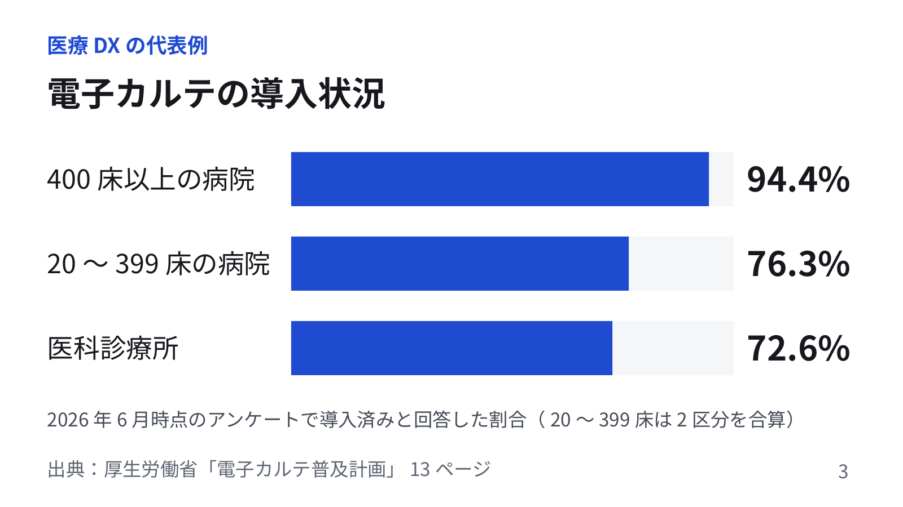
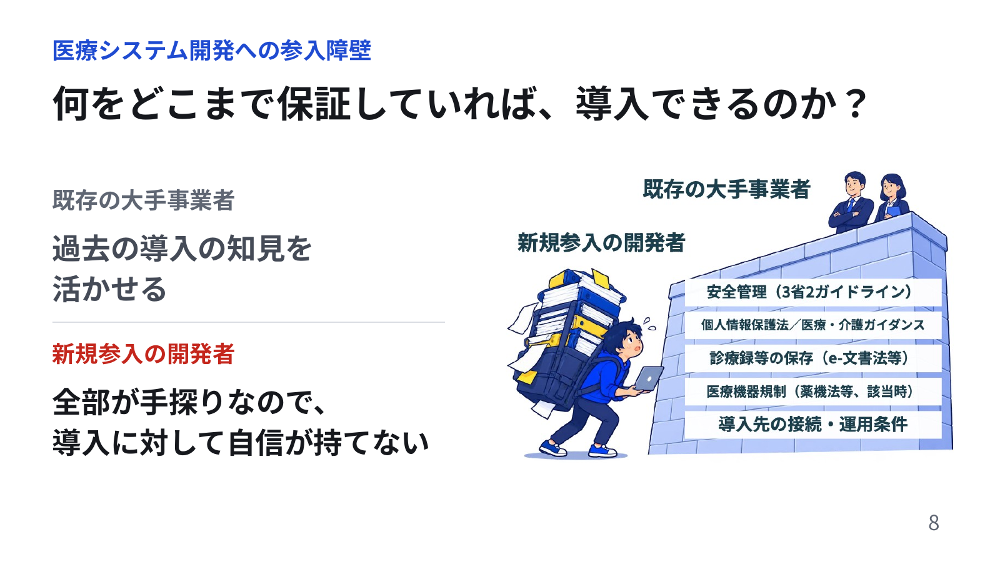
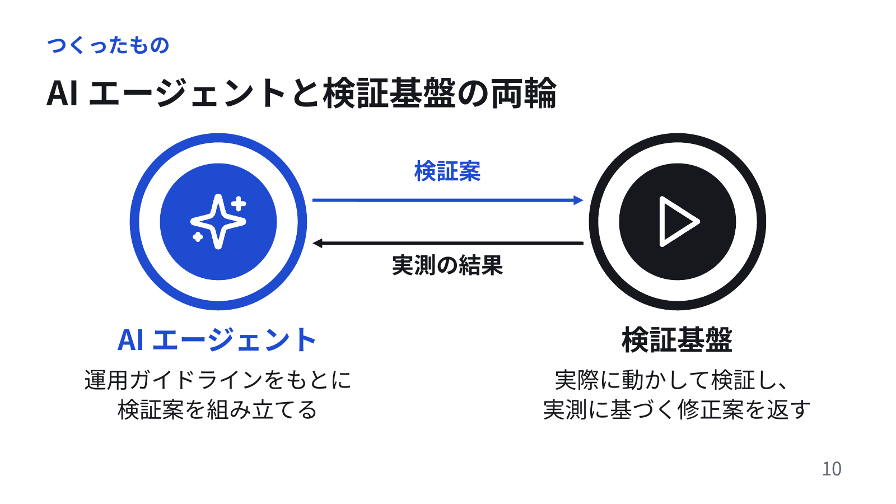
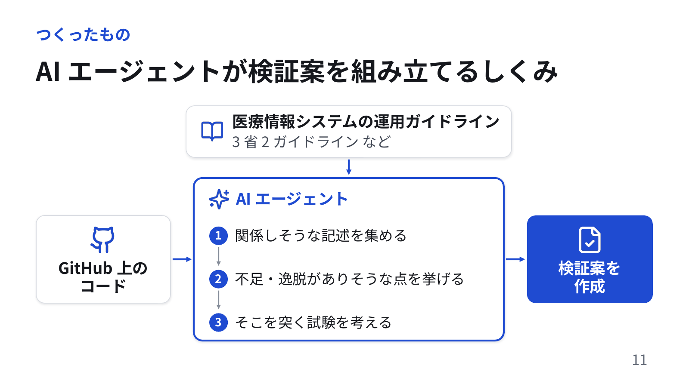
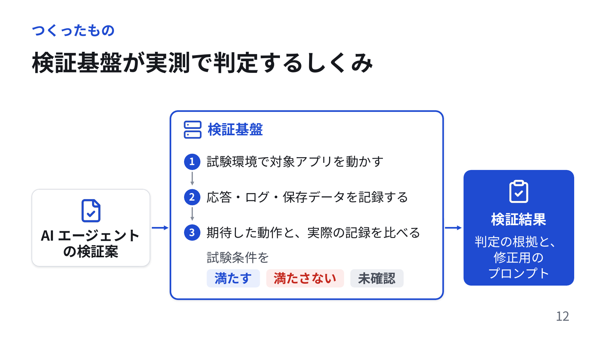
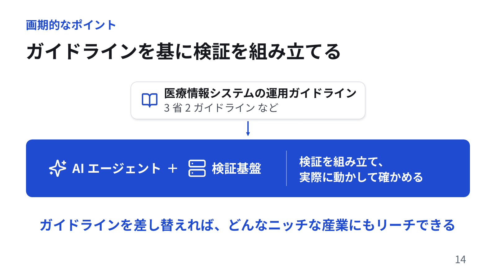
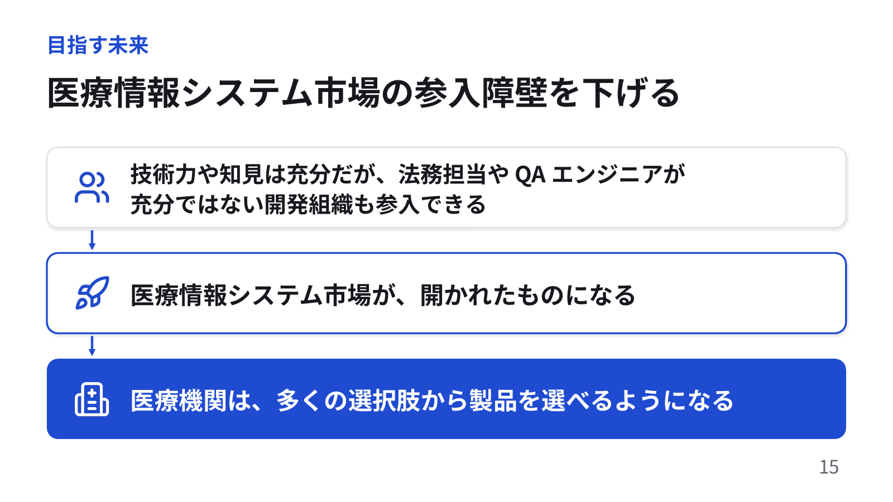

# AI×実測で行う、医療情報システム検証基盤

**医療情報システムの運用ガイドラインを基に検証を組み立て、対象のアプリを実際に動かして確かめる基盤です。**

AIエージェントがガイドラインとコードを照らし合わせて検証案を作り、検証基盤がアプリを試験環境で動かして、記録した事実だけで判定します。法務担当やQAエンジニアが充分ではない開発組織でも、医療情報システムの市場に参入できるようにすることを目指しています。

## 背景

医療DXは急速に進んでおり、電子カルテの周りにも、予約、問診、番号呼び出し、院内の連絡など、多くの情報システムがあります。

医療情報システムには、3省2ガイドラインをはじめ、個人情報の保護、診療録の保存、場合によっては医療機器の規制、導入先の接続や運用の条件まで、守るべき決まりが何重にもあります。既存の大手事業者は過去の導入の知見を活かせますが、新規参入の開発者は、どの要件が自分のシステムに当てはまるのか、それをどう確かめればよいのかを手探りで探すことになり、導入に自信が持てません。

足りない知見は、AIと実測による検証で補えばよい。そうすれば、小さなチームも診療所やクリニックの力になれる、と考えています。

## しくみ

AIエージェントと検証基盤の2つが両輪になって動きます。AIエージェントは検証案を作るだけで、合否は判定しません。判定するのは、実際に動かした記録を見る検証基盤です。

### AIエージェント：検証案を組み立てる

GitHub上のコードを受け取り、取り込んだ医療情報システムの運用ガイドライン（3省2ガイドラインなど）を基に、次の順で検証案を作ります。

1. コードに関係しそうな記述を集める
2. 不足・逸脱がありそうな点を挙げる
3. そこを突く試験を考える

AIエージェントは別のリポジトリ（mugiurushi-ai）にあります。

### 検証基盤：実測で判定する

検証案を受け取り、次の順で確かめます。検証基盤はこのリポジトリにあり、Rustで書いています。

1. 試験環境で対象アプリを動かす
2. 応答・ログ・保存データを記録する
3. 期待した動作と、実際の記録を比べる

結果は、試験条件を「満たす」「満たさない」「未確認」のいずれかで示します。記録が足りずに判定できない場合は「未確認」として残します。開発者には、判定の根拠と修正用のプロンプトを検証結果として返します。

## 画期的なポイント

ガイドラインを人が読み解いて確認項目を作るのではなく、ガイドラインを基に検証を組み立て、実際に動かして確かめます。そして、ガイドラインの部分を差し替えれば、同じしくみをどんなニッチな産業にも広げていけます。

## 目指す未来

1. 技術力や知見は充分だが、法務担当やQAエンジニアが充分ではない開発組織も参入できる
2. 医療情報システム市場が、開かれたものになる
3. 医療機関は、多くの選択肢から製品を選べるようになる

## ここまでの成果

架空の診療所アプリを対象に、ガイドラインとの照合から、検証案の作成、試験の実行、修正用プロンプトの表示までを、実際のモデルと実際の試験の実行で一気通貫に動かしました。4件の試験すべてで、担当外の職員への表示、操作の記録の欠落、保存先の外のファイル名の受け付けといった、ガイドラインから外れた動作を見つけています（[記録](docs/validation-clinic-demo-2026-11-07.md)）。

## これから

- **検証案から試験まで、全自動へ。** AIエージェントが組み立てた検証案を、そのまま試験の設定に落とし込み、ボタン一つで実測まで走らせます。
- **直して、また確かめる。** 修正用プロンプトで直した版を同じ条件で試し直し、前回の結果と比べて、確かに直ったことを示せるようにします。
- **特許の文書から、先人の工夫を学ぶ。** 公開されている特許の文書を照合に使う文書として取り込みます。既存の製品が個人情報や記録の扱いにどう配慮してきたかを読み、確かめ方のヒントにします。
- **ほかの産業へ。** ガイドラインを差し替えて、金融や行政をはじめ、決まりの多いあらゆる産業の参入障壁を下げていきます。

## 開発者向けの資料

- [開発の手引き](docs/development-guide.md)
- [構成](docs/architecture.md)
- [リポジトリの構成](docs/repository-architecture.md)
